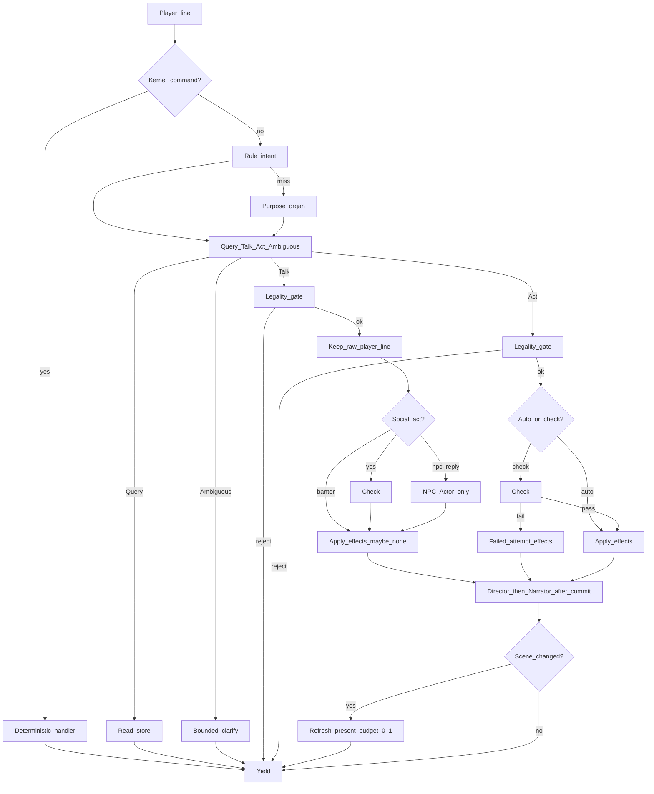

# HexBee Design Document

**Version:** 0.2  
**Date:** August 2026  
**Status:** Working architecture after requirements discovery  
**License intent:** MIT  
**Runtime intent:** Rust, local-first, OpenAI-compatible API  

This is not a frozen spec. Open items live in §21.

---

## 1. Purpose

HexBee is an open-source, local-first runtime that treats language models as organs, not as the operating system. The program owns memory, legality, persistence, routing, and **permissions**. Models perform narrow jobs: classify a line, speak as a character, judge whether an action is plausible, frame a scene, or draft a mail.

The useful slogan is incomplete: “making dumb AI smart.” The smarter part is scaffolding. Small models with short context (working assumption: ~40K-class local agents) become useful when they never have to remember the world, invent the rules, decide what is true, or fire a side effect.

Version 1 proves the kernel on a text RPG hex. That genre is a test harness, not the ceiling. If a short scene can be saved, killed, reloaded, and continued without stat drift or “I-win” exploits, the same kernel can later host a secretary hex and, after that, heavier creative or development hexes.

---

## 2. Problem

Unscaffolded LLM agents fail in predictable ways:

- They hold world state in the prompt and quietly rewrite it.
- They mix narration, rules, and planning in one completion.
- They accept impossible actions because the prose sounded good.
- They cannot be killed and resumed without losing the plot.
- Multi-agent trees spend tokens coordinating and never commit a fact.
- Small local models cannot carry a campaign, inbox, or book in context.
- Given a tool, they will eventually call it. Mail send, shell, and “schedule” are damage.

Existing multi-agent frameworks solve pieces of this. AI GM projects independently rediscover the same split: deterministic rules first, prose second. HexBee’s bet is to make that split a kernel rule, make **modules into functions with capability lists**, and default-deny every effect that can leave the machine.

---

## 3. Design thesis

> The program is the source of truth. The model reasons inside a contract. Side effects require a grant, then often a human lock.

Consequences:

- Persistence never lives in the model. Save files are the resume point.
- Organ outputs are typed. Free prose is allowed only for organs whose job is prose.
- World mutation happens only after validation.
- Bad output is a first-class event: parity check, then reprompt or reject.
- Hexes are functions: declared inputs, outputs, and effects.
- If a capability is not granted, the organ cannot do it — even if it emits perfect JSON that looks like a send.
- Scaffolding is the product. More agents is not.

---

## 4. Goals and non-goals

### 4.1 Goals for v1

- Solo terminal loop that is playable for one full short scene.
- Interpreter that distinguishes commands, queries, speech, actions, and attacks.
- Canonical campaign files (Markdown + JSON) that survive process death.
- GM / Director / Narrator / Character organs with separate jobs.
- Action pipeline that can refuse invented win conditions.
- Hot-seat ready identity: current actor is a setting, not a hardcoded hero.
- OpenAI-compatible local provider, with a clean path to optional cloud.
- Capability table and default-deny effects, even if v1 grants almost nothing dangerous.
- MIT license, readable repo, hex template sketched even if only RPG is implemented.

### 4.2 Non-goals for v1

- Graphical UI. Console first.
- Networked multiplayer. Hot-seat is enough.
- A published TTRPG ruleset. Use a small homemade stat block.
- Autonomous Director that runs unbounded without a yield.
- Email, calendaring, or “write me an app.” Those are later hexes.
- Training or fine-tuning models.
- A database server. Files only, so the project stays mobile.
- An open-ended shell or tool runner.

---

## 5. Users and use cases

| User | Use in v1 | Later |
|---|---|---|
| Operator / player | Type lines, switch actor, save, `options` | Approve mail, run other hexes |
| Hex author | Drop `world.md` + sheets + `hex.toml` into a folder | Template a secretary or book hex |
| Contributor | Add an organ, a provider, a validator | New hex types |

Primary v1 story: load the bundled micro-module, play a scene as one character, have the GM chase a written goal, hear the Narrator describe **committed** outcomes, switch actor for a hot-seat line, quit, reopen, continue.

---

## 6. System overview

### 6.1 Layers

| Layer | Responsibility |
|---|---|
| Shell | REPL, options, actor selection, reprompt / undo / save / quit / approve |
| Kernel | Interpreter, router, provider pool, validator, prompt assembler, **capability gate** |
| Store | Campaign tree on disk. Source of truth. Never the chat log alone. |
| Hex | Module-as-function: schema, organs, grants, command extras, legality |
| Organs | Narrow model calls with contracts. Some speak. Some return JSON only. |

### 6.2 Core loop

Rules and gates first; organs only on miss or to paint a **committed** beat.

1. Read a line from the current actor (or a kernel command).
2. Kernel command? → deterministic handler → yield.
3. Hex rule table classifies `Query | Talk | Act | Ambiguous`. Miss → **Purpose** organ.
4. **Query** reads the store (inventory / sheet / who) and answers without mutation → yield.
5. **Talk** keeps the player utterance as-is **only after** legality passes; optional **Actor** (NPC sheet only); social-pressure talk is Check-shaped → Apply (often no patches). Reject → yield (no organs).
6. **Act** proposes effects → legality / can-do / grants. **Reject → yield** (no Apply, no organs). Auto effects Apply; contested → **Check** → Apply success or failed-attempt only.
7. **Director** beat plan **after** committed patches; **Narrator** paints locked outcomes only — never before the gate.
8. Validator accepts or rejects each organ JSON payload (reprompt, bounded). Capability gate checks every patch.
9. Write the store and append the transcript.
10. Scene changed? Refresh Present / atmosphere under continue budget **0–1**, then always yield.



**Gate rule:** Legality reject → **Yield** with a static block line. No Actor, Director, or Narrator organ runs on that path. Director and Narrator paint only **after** committed patches.

### 6.3 Organs in the RPG hex

| Organ | Job | Output contract | Must not |
|---|---|---|---|
| Interpreter | Classify the line and destination | Intent JSON | Change the world |
| GM | Track module goals and story completion | Goal status, next pressure | Narrate or roll outcomes |
| Director | Control the current scene beat | Beat plan, focus, cuts | Invent items or kills |
| Narrator | Describe committed events and connect the scene | Prose only | Make mechanical calls |
| Actor | Speak / act in character from a sheet | Utterance + proposed gesture | Edit the sheet |
| Judge | Capability / legitimacy when rules are soft | Score + tags, no prose | Apply effects |
| Extractor | Pull fields from a long organ dump when needed | Patch JSON | Invent keys |

“GM style narrator” in conversation is this trio: **GM** holds the long goal, **Director** holds the scene, **Narrator** speaks. Combat outcomes are decided before the Narrator talks. If someone talks, the line is passed to the character actor, not improvised by the Narrator.

### 6.4 Three worlds: canon, presentation, situation

Split the module into three layers or the hex will write itself.

| Layer | What | May expand at runtime? | Who writes |
|---|---|---|---|
| **Canon** | Sheets, secrets, inventory, goals, quest flags | Only via authored apply / store patches | Program after check/act |
| **Presentation** | Atmosphere, NPC voice, stammer after a fail | Every turn (prose only) | Actor / Narrator organs |
| **Situation** | Attitude, heat, time, declared runtime flags | Every turn, declared knobs only | Program via `SituationKnob` |

**Canon** (`worlds/canon.rs`) — what is true. No new factions, items, secrets, or DCs unless a human (or later authoring hex) writes them to disk. Models never call `apply_canon`.

**Presentation** (`worlds/presentation.rs`) — what it feels like. May expand every turn. Must not add items, DCs, or secrets.

**Situation** (`worlds/situation.rs`) — what changed in play. Expands constantly, but only along knobs the hex declared (`attitude`, `scene_heat`, `clock_beats`, `SituationFlag`).

#### Secrets, checks, and off-script play (tavern hex)

**Base DC** lives on authored secrets in `campaign/secrets.yaml` — not on the LLM. Same line bound to the same secret in the same store state yields the same DC band.

**Modifiers** are listed, numeric, and read only from canon + situation (`player.*`, `attitude.*`, `checks_failed.*`, `scene_heat`, …). Example: `player.sally_tip_discount` −4 on charm Sally; prior fails on `groll_storage_password` +2/+2.

**Locks** block the roll entirely — they are not DC tweaks. Example: `actor.groll.sworn_silent` → “He swore silence…” with **no d20**. Flavor via Actor/Narrator is still allowed.

**Talk path binding** (rules, not Purpose):

1. **Bind** — map the line + addressee onto a named secret (`bind_any` keywords). “Why is the cellar locked?” can hit `groll_storage_password` even if the module prose expected “pick the lock.”
2. **Fail closed on facts** — if nothing binds: banter (Actor only) or **generic social move** (mid DC bag). Never mint loot, secrets, or goal completion at runtime.
3. **Generic move bag** (off-book) — attitude warmer/colder/alert, scene heat, time beat, stay/leave. Only `SituationKnob` values move situation.
4. **No runtime bible** — honest NPC answers: don’t know, won’t say, lie only if `will_lie` / sheet flag exists, or point at scene props.
5. **Clarify gate** — kernel-only question when ambiguity could change the store or spend a check (see §6.5). One ask per line; never chain clarify → Purpose → clarify.
6. **Promote later** — repeated off-script pokes become new rows in `secrets.yaml`; the model does not author them mid-scene.

Check pipeline: bind → locks → DC (base + store modifiers) → d20 + skill → **canon apply** (authored) + **situation knobs** (generic) → **NPC Actor** flavors the player’s exact words (LLM paints only).

#### 6.5 Clarify gate (kernel only)

Clarify is a **gate for dangerous ambiguity**, not general chat. Unclear flavor is allowed to stay flavor. Unclear intent to pick a lock, extract a secret, or fire a command must not be guessed.

**Ask** when the next step could change the store or spend a check:

| Trigger | Example |
|---|---|
| Command vs in-world | “options” in speech vs `options` command |
| Flavor vs social move | “just talking, or trying to get him to talk?” |
| Two lexicon hits of equal weight | tied actor/secret topics |
| Move with no bound topic | “persuade whom about what?” |
| Interpreter confidence below threshold | Purpose `confidence < 0.6` on dangerous intent |

**Do not ask** when the safe default is cheap:

- Pure unmatched chatter → flavor talk, no check, no patches
- Obvious command from the kernel list
- Bound topic + clear verb
- After you already asked once on this line

**How to ask:** one short kernel question, two or three numbered options, plus banter as the escape (`❓` prefix). **Do not** send clarify through Narrator or Actor. **Do not** start a meta-conversation with the model about what the player “really meant.”

**Give up cleanly:** shrug or off-axis answer → commit flavor and yield (`YieldFlavor`). Never chain clarify → Purpose organ → clarify again.

---

## 7. Modules are functions

A hex is not a vibe pack. It is a function the kernel calls.

```
hex(intent, store_slice, grants) -> { patches, prose, drafts, lock_requests }
```

It declares:

- **inputs** it may read (scene, sheet slice, inbox headers — not the raw keyring)
- **outputs** it may propose (store patch, draft, narration)
- **effects** that are allowed at all
- **locks** on every dangerous effect: propose only, human must approve, or program-only

Creating a new hex should eventually be “copy the template, write `world.md`, add sheets, tune prompts, list grants.” v1 is allowed to put RPG legality in Rust. The template is not finished until a second hex exists.

Compose functions. Do not let an LLM become the composer of side effects.

Examples of organ functions:

| Function | Returns |
|---|---|
| Interpreter | `Intent` |
| Judge | `Score` |
| Action manager (program) | `Patch[]` |
| Narrator | `Prose` (no patches) |
| Mail organ | `Draft` (no send) |
| Approver (human) | `Unlock` |

---

## 8. Capability and locks

This is the permission model. Scaffolding without it is just a prompt router.

### 8.1 Default deny

The kernel starts from an empty grant set. An organ may **emit** a request. It may not **perform** an effect. The provider layer never grows `send()`, `exec()`, or `schedule()` because a completion asked for one.

### 8.2 Capability catalog (initial)

| Capability | What it means | v1 RPG | Stage 2 mail | Stage 3 build |
|---|---|---|---|---|
| `store.read` | Read granted slices of the campaign | grant | grant | grant |
| `store.patch` | Apply validated patches to hex-owned keys | grant (narrow) | grant (narrow) | grant (narrow) |
| `transcript.append` | Write a committed beat | grant | grant | grant |
| `model.complete` | Call the provider | grant | grant | grant |
| `net.http` | Outbound HTTP other than the provider | deny | deny | lock |
| `mail.read` | IMAP fetch into store objects | deny | grant | deny |
| `mail.draft` | Create a draft object | deny | grant | deny |
| `mail.send` | SMTP send | deny | **hard lock** | deny |
| `mail.delete` | Destroy a remote message | deny | **hard lock** | deny |
| `cal.schedule` | Create a calendar event | deny | **hard lock** | deny |
| `fs.write_outside_campaign` | Touch files outside the campaign tree | deny | deny | lock |
| `proc.exec` | Run a subprocess | deny | deny | lock |
| `audio.control` | Change host volume / music | lock / stub | deny | deny |

Narrow `store.patch` means the hex lists writable paths (`actors.*.inventory`, `scenes.*.flags`, `state.current_scene`, …). A Judge or Narrator that returns `actors.pc.stats.might = 99` is rejected by the gate, not debated.

### 8.3 Lock kinds

| Kind | Behavior |
|---|---|
| `deny` | Drop the effect. Log it. Tell the operator if it was explicit. |
| `grant` | Allowed after schema and legitimacy checks. |
| `lock` | Organ may only create a `LockRequest`. Shell must `approve <id>` with the exact payload shown. |
| `program` | Only kernel code may perform this. Models may not request it. |

Hard locks are how LLMs cannot do damage. Stage 2 mail can draft freely. It cannot send. The approve command prints the exact To / Subject / Body (or schedule record) and waits. No silent side effects. No “the model said it was fine.”

### 8.4 Where the gate sits

```
organ output
  → schema / parity validator
  → capability gate (grants + writable paths)
  → lock queue OR commit
```

The gate is kernel code. Hexes may *declare* grants in `hex.toml`. They may not raise their own ceiling at runtime.

### 8.5 Operator commands

- `grants` — show the active hex capability table
- `locks` — list pending lock requests
- `approve <id>` — release one request after display
- `deny <id>` — discard it
- `options` — includes continue budget, actor mode, provider map; audio stubs live here behind `audio.control`

---

## 9. Interpreter

The interpreter sits in front of every hex. It must notice that `options` is a settings command even during play, and that “I raise the volume of my voice” is in-world.

### 9.1 Strategy

Hybrid, because the models are small:

1. **Rules first.** Leading slash commands, exact menu words (`options`, `save`, `load`, `quit`, `actor`, `undo`, `reprompt`, `approve`, `grants`, `locks`), inventory verbs with known item ids.
2. **Interpreter organ** on anything still ambiguous. Contract is Intent JSON only.
3. **Ask the human** if confidence is low. Do not guess a mutation.

### 9.2 Intent schema (v1)

`kind`, `hex_target`, `actor_id`, `verb`, `object_ids[]`, `raw`, `confidence`, `notes`.

`kind` is an enum. Unknown kinds are `Ambiguous`, never “just send it to the Narrator.”

### 9.3 Command table (kernel)

| Input | Effect |
|---|---|
| `options` | Settings: provider, audio stub, actor mode, continue budget |
| `save` / `load` | Write or choose a campaign folder |
| `actor <id>` / `next` | Hot-seat: specific character or round-robin |
| `reprompt` | Resubmit last organ call without committing |
| `undo` | Revert last committed store snapshot if present |
| `goal` | Print GM goal status from store, not from a model |
| `grants` / `locks` / `approve` / `deny` | Permission surface |
| `quit` | Save-if-dirty and exit |

---

## 10. Memory and persistence

### 10.1 Policy

Keep persistence out of the LLM. The kernel assembles each prompt from the store plus a short working window of the transcript. Sometimes the whole validated organ dump is kept (Narrator paragraph for the scene log). Sometimes only extracted fields are kept (Judge score, inventory delta). Program plus Extractor organ decide which.

### 10.2 Why files, not a database

The project should be mobile: copy a folder, kill the process, open it elsewhere. A campaign is a directory of JSON and Markdown. No database server. Optional later: zip export. This also plays well with Obsidian: `world.md` and notes are readable as notes.

### 10.3 Campaign layout

```
campaign/
  hex.toml              # module id, organs, grants, provider overrides
  world.yaml            # setting, tone, hard flags, soft details
  goals.yaml            # story completion criteria
  scenes/<id>.yaml      # location, occupants, exits, props, flags
  actors/<id>.yaml      # sheet, inventory, relationships, voice
  secrets.yaml          # authored checks, when the hex has them
  state.json            # current scene, current actor, clock, budget
  transcript.jsonl      # append-only committed beats
  drafts/               # stage 2: proposed mail / schedule (unsent)
  locks/                # pending LockRequests
  snapshots/            # last N commits for undo / crash
```

### 10.4 Character sheet (minimum)

`id`, `name`, `player_controllable`, `voice`, `traits[]`, `stats{}`, `inventory[]`, `flags[]`, `known_facts[]`, `relationships{}`.

Stats stay generic so hex authors can slide in their own games. The tavern hex ships an **SRD 5e-shaped** sheet: six abilities (STR–CHA), eighteen skills, proficiency bonus, and simple build presets (Face / Scout / Scholar / Bruiser). Contested beats resolve as **d20 + ability mod + proficiency (if skilled) vs DC**. The kernel Check slot stays ruleset-agnostic.

### 10.5 Prompt assembly

Each organ gets only what it needs: sheet slices, current scene, relevant flags, last few transcript lines, the contract reminder, and **no grant it does not have**. Sheets are never dumped whole into every call. That is the memory manager in v1: paging by role, not a vector database.

---

## 11. Action and legitimacy pipeline

This is the structure that stops Kamehameha-as-I-win.

1. Interpreter says `Action` or `Attack`.
2. Action manager resolves object ids against inventory, scene props, and flags.
3. If the object is missing, reject with a kernel message. **Yield — no organ calls.**
4. If the verb is trivially legal (“drink the potion you hold”), skip Judge.
5. Otherwise Judge receives: actor sheet slice, action, targets, scene flags. Returns a score and tags only.
6. Program applies hex rules to the score (threshold, opposed check, or “narrate attempt, no effect”).
7. Effects are a list of store patches: wound, flag, inventory move, scene change.
8. Capability gate checks writable paths.
9. **Director** receives the committed patches and chooses the next beat (including whether an NPC answers).
10. **Narrator** receives patches + beat and writes prose. Narrator does not add new patches.
11. If speech was the intent, **Actor** runs **after** the legality gate passes — never before.

A player line is also read as a verb and a kind before that pipeline runs. The verb is `ask`, `look`, `talk`, or `act`. The kind is `character`, `creature`, `object`, or `place`. The program searches only that pile. Ask and look answer from it. Talk uses a voice when that entry has one. An action names an ability — Strength, Dexterity, Constitution, Intelligence, Wisdom, or Charisma — and the program rolls `d20 + modifier` against a DC in the local band. Constitution is a raw ability check. An authored secret keeps its own skill. The roll does not grant loot or finish the module.

---

## 12. Player identity and hot-seat

The current actor is a setting, not the architecture.

| Mode | Behavior |
|---|---|
| Single | One controllable sheet. Default for v1 demos. |
| Select | Prefix or command chooses who acts this line. |
| Round-robin | A spending action resolves immediately, then the next seated sheet is prompted. When every seated sheet has acted, one NPC phase opens the next round and the first seat goes again. |

The kernel records whose line it was on the transcript. Networked multiplayer is out of scope; the data model should not forbid it later.

---

## 13. Turn and continue policy

A spending line resolves immediately: rules, check, and narration, then yield. Look, inventory, sheet, price, dict, help, and a clarify question answer in place and do not spend the turn. `next` passes the seat without an action and counts as having gone.

When every seated player has gone, the round closes. One present NPC may speak or shift attitude or heat from the committed outcomes. That phase cannot grant loot, move the party, or finish a goal. The clock ticks once, the table clears, and the first seat is prompted. With one seated player, the NPC phase follows every spending action.

Director may request a continue (NPC reply, environmental tick) up to a small budget in `options` (start at 1). Each continue still validates and can be halted with any human keystroke or a failed parity check. Unbounded simulation is a later experiment, not v1 behavior.

---

## 14. Validation, parity, and reprompt

LLM output is untrusted. HexBee treats that as normal.

### 14.1 Program checks first

If we know what bad looks like, the program checks it: JSON parse, required keys, enum membership, score in range, no unknown item ids, no sheet fields the organ is forbidden to touch, length caps, refusal of undeclared effects. Cheap and deterministic.

### 14.2 Critic organ when meaning is the problem

When the payload is well-formed but possibly illegitimate (“the peasant draws a satellite laser”), a critic organ — or a second sample from the same Judge — votes. Disagreement → reject and reprompt with both outputs attached. Optional per hex. Off by default if only one local slot is loaded.

### 14.3 Reprompt

The last organ request is kept in working memory until commit. Shell command `reprompt` resends with an optional human note. After N failures (default 2), surface the raw payload to the operator: accept patch, edit, or discard. Never auto-commit a failed contract.

---

## 15. Providers and models

v1 talks to a local OpenAI-compatible HTTP API. Cloud is the same trait with another base URL and key. Organs declare preferred roles (tiny classifier, mid actor, mid narrator). The kernel maps roles to model ids in options so operators can plug many model types without code changes.

Assumption: models are short-window and weak. Design for that. Do not hide a huge cloud model as the real architecture.

Concurrency: local VRAM is scarce. Default is one in-flight completion. “Worker threads” are logical organs and queued jobs, not parallel model loads. A later scheduler may serialize multiple organs onto one slot.

---

## 16. Hex modules

A hex is a folder that plugs into the kernel: scaffolding plus optional Rust hooks. “Write me a book” and “Email Bob and schedule a meeting” are hexes. They are not v1 deliverables.

### 16.1 Hex contract

- `id`, `name`, `version`
- state schema
- organ list and default prompts
- extra commands
- **grant table**
- writable store paths
- legality hooks (inventory, flags, effects)
- entry point (scene / mailbox / task)

### 16.2 Bundled v1 hex

Ship one short module: a single location or two, three actors, one GM goal that can complete. World and goals live in docs the GM organ reads. Sheets are individual files. An old GM prompt is split into `world.md`, `goals.json`, and organ system prompts — not one blob.

---

## 17. Staged roadmap

### Stage 0 — Kernel spike

- Rust CLI REPL
- Provider trait + local API client
- Rule-first interpreter + stub organ
- Campaign folder load/save
- `options` / `save` / `quit` on a dummy hex
- Capability table present even if only `store.*` and `model.complete` are granted

### Stage 1 — RPG hex playable

- Sheets, scene, inventory, flags
- GM, Director, Narrator, Actor, Judge
- Action pipeline with trivial and judged paths
- Hot-seat actor setting
- Kill process, reload, continue the same scene
- Success test: one short complete scene, no stat desync, `options` never swallowed by the Narrator

### Stage 1.5 — Hardening

- Snapshots and undo
- Parity / critic optional path
- Prompt assembly budgets per organ
- `hex.toml` validation including grants
- Operator-visible traces (which organ ran, what was committed, what was denied)

### Stage 2 — Secretary hex

- IMAP/SMTP as structured objects in the store
- Drafts only by default (`mail.draft` granted)
- Hard locks on `mail.send`, `mail.delete`, `cal.schedule`
- Same interpreter, same persistence rules, same gate

### Stage 3 — Creative / build hexes

- Book, research, or app-building modules
- Dynamic manager trees spawned per task
- `proc.exec` and extra filesystem only behind locks
- Still no model-owned persistence

---

## 18. Runtime and repo shape

Language: Rust. One binary, strict types for store patches and lock requests.

Indicative crates (not mandated): a small REPL helper; `serde` + `serde_json`; `reqwest` or `ureq`; `jsonschema`; `thiserror`; `tracing`. Keep the surface small.

Suggested layout:

- `hexbee` (bin)
- `hexbee-kernel`
- `hexbee-store`
- `hexbee-provider`
- `hexbee-hex-rpg`
- later `hexbee-hex-mail`

User `hexes/` directory so third-party games do not require a rebuild once the hook story is real.

**License:** MIT. People should slide in games and fork organs. Apache-2.0 is the alternative if a patent grant matters later. Lean MIT.

---

## 19. Security and safety stance

- Local by default. Cloud keys live in a user config file, never in the campaign tree.
- Models cannot execute shell commands in v1.
- Campaign files are trusted like any local save game. Do not eval them.
- Logs may contain story content; do not upload traces unless the operator says so.
- **Hard locks on anything that leaves the machine or destroys remote state.**
- Hexes cannot raise their own capability ceiling at runtime.

---

## 20. Risks

| Risk | Mitigation |
|---|---|
| Interpreter eats in-character `options` or misses a command | Rule pass first; confirm on low confidence |
| Small models break JSON contracts | Retry with schema echo; fall back to human |
| Director loops | Continue budget, always yield |
| Prompt bloat | Role-sliced assembly, not full sheets |
| Scope bleed into mail and codegen | Hex boundary; stages 2–3 stay closed until Stage 1 ships |
| One-off RPG code that cannot become a template | Write `hex.toml`, grants, and store layout as if a second hex exists |
| Model-emitted “send” that looks valid | Capability gate; no provider method until lock release |

---

## 21. Success metrics for v1

- A stranger can clone, point at a local API, and finish the bundled scene.
- After SIGINT and reload, inventory, wounds, scene id, and current actor match the last commit.
- `options` opens settings from inside a heated scene.
- “I vaporize the boss with an unlisted power” is rejected or reduced to a failed attempt with no store cheat.
- Switching actor and speaking in that voice works for at least two sheets.
- A hex author can change `world.md` and a sheet without recompiling (prompts and docs). Legality hooks may still be compiled in v1.
- An organ that requests `mail.send` in the RPG hex is denied and traced.

---

## 22. Open items

- Exact homemade stat block and whether opposed checks exist in the bundled module.
- Whether music/volume in `options` is a real local audio stub or a reserved command.
- Critic organ on by default vs opt-in.
- How much of the old GM prompt becomes `world.md` versus system prompts — owner will split this.
- Hot-reload of hex files during a session.
- Campaign format version field so future HexBee can migrate saves.
- Whether `approve` can take an edited payload or must match the request byte-for-byte.

---

## 23. Immediate next build step

Implement Stage 0 in Rust: a REPL that loads a campaign folder, classifies a line with rules, calls one local model through a provider trait, writes `state.json` and `transcript.jsonl`, survives restart, and carries a grant table even if the only grants are `store.read`, `store.patch` (narrow), `transcript.append`, and `model.complete`.

Do not start the Narrator until save/load, `options`, and deny-by-default effects work.

The scaffolding is the product.

---

*v0.2 adds §7 Modules are functions and §8 Capability and locks. Previous Word export (v0.1) is superseded for working notes.*
